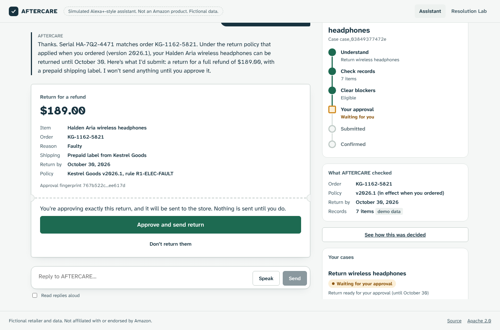
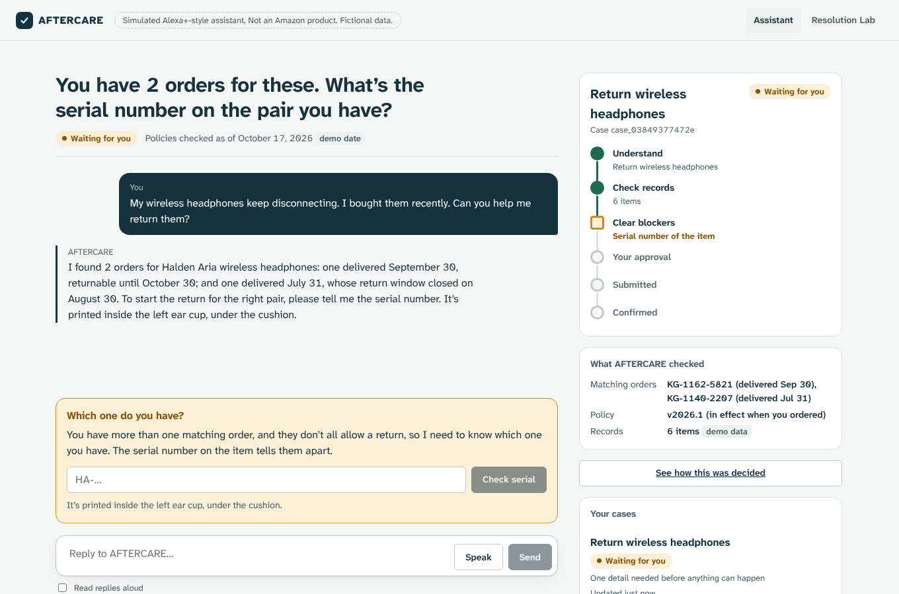
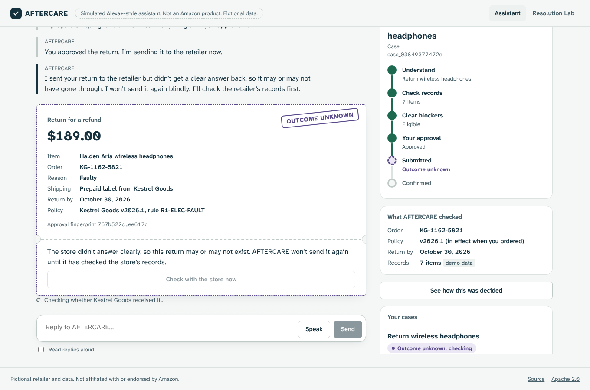
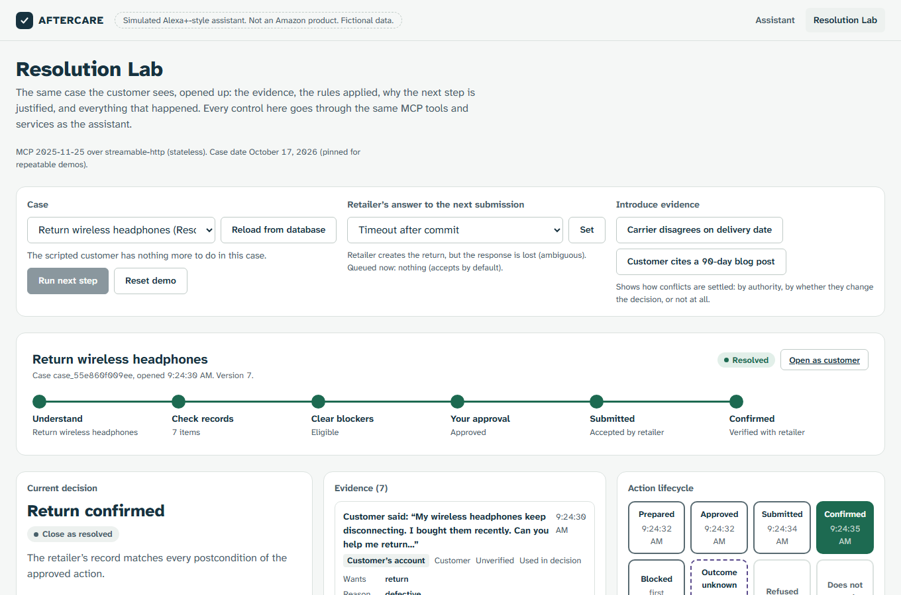
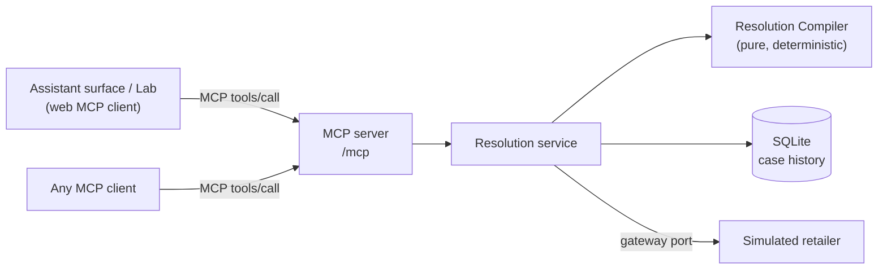

# AFTERCARE

**A purchase-resolution agent that knows when it cannot safely proceed.**

AFTERCARE helps a customer sort out a problem with something they bought, such as a return. It opens a persistent case, checks the order and the store's actual policy, asks only for what it needs, and acts only after the customer approves the exact terms. Then it confirms the outcome with the store before calling anything done. When the evidence is incomplete, conflicting or uncertain, it says so and stops instead of guessing.

Built for the **Alexa+ track** of the Amazon Developer Hackathon (AmazonAppDev 2026) as a **self-hosted MCP server** (spec 2025-11-25, Streamable HTTP). A web app plays the role of an Alexa+-style assistant and calls the server's MCP tools.

> **Not an Amazon product, and not connected to Alexa.** The web assistant is a clearly labelled simulation. The retailer _Kestrel Goods_, its policies, orders and customer are fictional. No real return, refund or label is ever created.



## The flagship scenario: Return Rescue

> "My wireless headphones keep disconnecting. I bought them recently. Can you help me return them?"

1. **Understand.** AFTERCARE extracts the goal (return), the reason (a fault) and the product.
2. **Establish evidence.** It finds **two** orders for the same headphones, plus **two** versions of the store's return policy. The policy changed on Oct 1 from 30 days to 15.
3. **Block correctly.** The older pair's window closed on Aug 30; the newer pair is returnable until Oct 30. Starting a return for the wrong order would be wrong, so it asks which pair the customer has.
4. **Resolve the blocker.** The customer reads the serial number. A wrong serial is checked against shipment records and rejected; the right one identifies the order.
5. **Plan and authorize.** It drafts a return using the policy version **in effect when the item was ordered**, with explicit preconditions and expected postconditions. Saying "yes, go ahead" in chat is not approval. Approval is recorded only through an explicit approve call that names the exact proposal and its SHA-256 fingerprint; if the evidence changes, that approval no longer applies. Over MCP, the assistant calling the tool is responsible for asking the customer (see [the threat model](docs/THREAT_MODEL.md)).
6. **Execute and recover.** The store creates the return but the response is lost. The case shows **Outcome unknown**. AFTERCARE does not resubmit: it looks the request up by its idempotency key, finds it, then verifies the record against what was approved.
7. **Confirm and resume.** Only then is it **Confirmed**. Reloading, or restarting the server, resumes the case from the database with its full history.

| Blocked: which pair?                                                                                                        | Outcome unknown                                                                                                     | Resolution Lab                                                                                            |
| --------------------------------------------------------------------------------------------------------------------------- | ------------------------------------------------------------------------------------------------------------------- | --------------------------------------------------------------------------------------------------------- |
|  |  |  |

## Quick start

Requires **Node.js 24+** (uses the built-in `node:sqlite`). No API keys or accounts needed.

```bash
npm install
npm run build      # builds the web app
npm start          # http://127.0.0.1:8787
```

- Assistant surface: http://127.0.0.1:8787/
- Resolution Lab: http://127.0.0.1:8787/lab
- MCP endpoint: `http://127.0.0.1:8787/mcp` (Streamable HTTP, stateless, protocol 2025-11-25)

Other commands:

| Command             | What it does                                                                           |
| ------------------- | -------------------------------------------------------------------------------------- |
| `npm run db:reset`  | Restore the demo's starting state (removes demo cases, reseeds the fictional retailer) |
| `npm run dev`       | Server with reload plus the Vite dev server on http://127.0.0.1:5173                   |
| `npm run mcp:smoke` | Connect to a running server with the official MCP client, list tools, open a case      |
| `npm run eval`      | Rerun the evaluation and regenerate its results                                        |
| `npm run check`     | Type-check, lint, format check, unit and integration tests                             |
| `npm run test:e2e`  | Playwright end-to-end tests (run `npx playwright install chromium` once)               |

Configuration is optional. See [`.env.example`](.env.example); a `.env` file is read if present.

## Deployment

### Live demo

| Surface           | URL                                       |
| ----------------- | ----------------------------------------- |
| Assistant surface | https://aftercare-mxfm.onrender.com/      |
| Resolution Lab    | https://aftercare-mxfm.onrender.com/lab   |
| MCP endpoint      | `https://aftercare-mxfm.onrender.com/mcp` |

No token or account is needed. Every record is fictional, and the Lab's reset button (or `POST /api/demo/reset`) restores the starting state. Try it with the official MCP client:

```bash
npm run mcp:smoke -- https://aftercare-mxfm.onrender.com/mcp
```

It runs on Render's free plan (Virginia). **After 15 minutes without traffic the service sleeps, and the next request takes about a minute.** There is no persistent disk, so cases reset whenever it sleeps or redeploys. See [Known limitations](docs/KNOWN_LIMITATIONS.md).

**Cold starts.** If the server went to sleep while the page was open, the web app shows "Waking the demo, this can take about a minute" and retries on its own for up to about 90 seconds, instead of showing an error. It retries only reads and a harmless health check; a tool call is never sent twice. An MCP client calling `/mcp` directly may time out on its first call after a sleep; calling again once the server answers works.

**Keeping it warm during judging.** A free external uptime monitor that requests `https://aftercare-mxfm.onrender.com/api/health` every 10 minutes keeps the free instance from sleeping. It is set up by hand, outside this repository; the repository contains no code that pings itself.

**Rate limit.** `/mcp` and `/api` accept up to 600 requests per client address per minute (`AFTERCARE_RATE_LIMIT_PER_MINUTE`, 0 turns it off) and answer 429 with a short message above that, so one script cannot take the shared demo down. The limit is kept in memory.

### Running your own

AFTERCARE is one Node.js 24 process with a SQLite file. Nothing else is needed.

1. `npm ci && npm run build`
2. Set `HOST=0.0.0.0`, a `PORT`, and `AFTERCARE_ACCESS_TOKEN` (16+ characters; the server refuses to listen on a non-loopback address without it). Set `AFTERCARE_ALLOWED_ORIGINS` to the public origin, and `DATABASE_PATH` to a persistent disk.
3. `npm start`. MCP clients then call `https://<host>/mcp` with `Authorization: Bearer <token>`.

The web app does not send a token, so a token-protected deployment serves MCP clients only. The live demo instead sets `AFTERCARE_PUBLIC_DEMO=true`, which allows a public `HOST` without a token. That is acceptable only because all data is fictional; see [the threat model](docs/THREAT_MODEL.md).

## How it works



- **Resolution Compiler** (`src/domain/compiler.ts`): a pure function from case state to one justified next step. It resolves facts with an explicit authority policy, picks the governing policy version, and tests unresolved conflicts for whether they change the decision. It evaluates every candidate action's preconditions and asks only for information that matters. Every assessment is validated against a schema and cross-field invariants before use.
- **Execution safety:** scoped approvals by digest, a write-ahead operation record, reconciliation before any retry, the same idempotency key across retries, and postcondition verification before "confirmed".
- **Persistence:** SQL migrations, transactional writes, an event per significant step, and restart recovery for interrupted submissions.
- **No model in the decision path.** Language is interpreted by a deterministic rules interpreter behind a port; decisions never depend on generated text.

Details: [docs/ARCHITECTURE.md](docs/ARCHITECTURE.md).

### MCP tools

`start_return_case`, `continue_case`, `provide_item_serial`, `approve_proposed_return`, `decline_proposed_return`, `submit_approved_return`, `check_return_outcome`, `get_case`, `list_my_cases`, `explain_decision`.

Each returns typed `structuredContent` with a short `speech` line for voice and a `display` card for screens.

## Measured results

22 hand-labelled synthetic scenarios, each run against AFTERCARE and two simpler agents with the same tools. The baseline has none of the controls. The careful baseline selects the policy version by order date, reuses one request key across retries and reads the return back before confirming, but has no approval digest, no rule for conflicting evidence and no case state machine. Scores come from the simulated retailer's own records, judged after it has finished processing.

|                               |   AFTERCARE | Baseline | Careful baseline |
| ----------------------------- | ----------: | -------: | ---------------: |
| Correct outcome, S01 to S14   | **14 / 14** |   7 / 14 |           9 / 14 |
| Correct outcome, S15 to S22   |   **8 / 8** |    4 / 8 |            7 / 8 |
| Correct outcome, all 22       | **22 / 22** |  11 / 22 |          16 / 22 |
| Wrongful denials              |           0 |        4 |                0 |
| Missed blockers               |           0 |        1 |                1 |
| Authorization violations      |           0 |        2 |                2 |
| Wrong terms submitted         |           0 |        2 |                2 |
| Unsupported actions           |           0 |        1 |                2 |
| Duplicate submission attempts |           0 |        2 |                0 |
| Confirmed before verifying    |           0 |       10 |                0 |

S01 to S14 are the original set; their results for AFTERCARE and the baseline are unchanged. S15 to S22 were added later, with labels committed before any run. These are behaviour tests on a small synthetic set written by the same team, not statistical estimates. The baselines are reference points, not measurements of any particular LLM. "Confirmed before verifying" counts claims made before checking; in this sandbox those returns were later authorized. Definitions, per-scenario results and limitations are in [docs/EVALUATION.md](docs/EVALUATION.md).

## Tests

- **79 unit, integration and transport tests** (`npm test`). They cover the authority policy, policy versions, the lifecycle, compiler decisions and invariants; the full flagship journey through the application layer, including restart and crash recovery; MCP over real HTTP with the official client; and exact reproduction of the evaluation results.
- **7 Playwright end-to-end tests** (`npm run test:e2e`). They cover the full journey in a real browser, the refusal path, Lab controls, a real server restart mid-case, axe accessibility checks, keyboard-only approval, and phone-width layout.

## Repository map

```
src/domain/          compiler, evidence & authority, policies, lifecycle, actions, verification
src/application/     use cases, ports, evidence factory, read models, demo controls
src/infrastructure/  SQLite repository, retailer sandbox, rules interpreter
src/interfaces/      HTTP app and MCP tools
src/evaluation/      scenarios, baseline, harness
web/                 assistant surface and Resolution Lab (React, Vite)
migrations/          SQL schema
data/seed/           fictional retailer, orders and policies
tests/, e2e/         vitest and Playwright suites
docs/                requirements, architecture, threat model, evaluation, demo script, limitations
```

## Documentation

- [Competition requirements and route decision](docs/COMPETITION_REQUIREMENTS.md)
- [Architecture](docs/ARCHITECTURE.md)
- [Threat model](docs/THREAT_MODEL.md)
- [Evaluation](docs/EVALUATION.md) and [generated results](docs/EVALUATION_RESULTS.md)
- [Demo script](docs/DEMO_SCRIPT.md)
- [Known limitations](docs/KNOWN_LIMITATIONS.md)
- [Product feedback draft](docs/PRODUCT_FEEDBACK.md)
- [Adversarial review findings and resolutions](docs/REVIEW_FINDINGS.md)

## License

[Apache-2.0](LICENSE).
