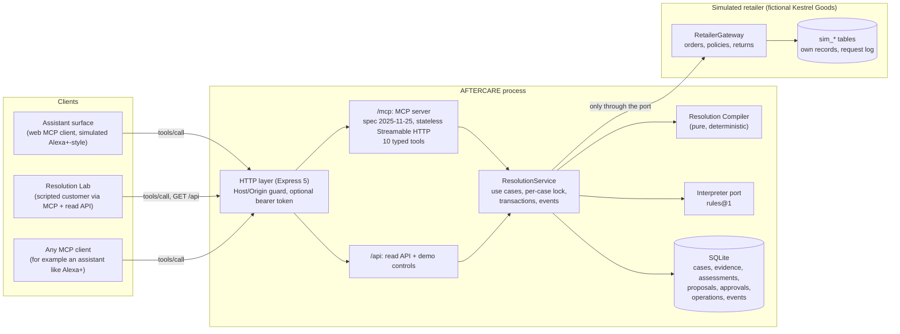
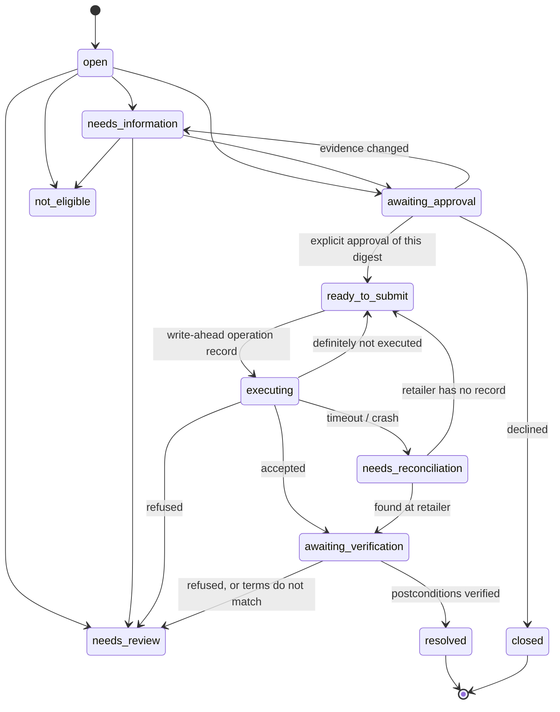

# Architecture

AFTERCARE is a single Node.js process (TypeScript, Node 24). It hosts four things: an MCP server, a read API, the web app, and a simulated retailer. Every interface calls the same application services, and those services ask one pure function, the Resolution Compiler, what may happen next.

## System context

The simulated retailer shares the SQLite file for convenience, but it lives in its own `sim_*` tables. The application reaches it only through the `RetailerGateway` port. It never reads those tables directly, so a lost response creates real uncertainty that AFTERCARE has to resolve by asking the retailer.

## Layers and dependency direction

| Layer          | Location                    | Responsibility                                                                                                 | May depend on                                    |
| -------------- | --------------------------- | -------------------------------------------------------------------------------------------------------------- | ------------------------------------------------ |
| Presentation   | `web/src`                   | Renders persisted state; sends customer actions as MCP tool calls; no business rules                           | Server read-model types only (type-only imports) |
| Interfaces     | `src/interfaces/{http,mcp}` | Transport, validation of untrusted input, error mapping, auth guard                                            | Application                                      |
| Application    | `src/application`           | Use cases, evidence gathering, write-ahead operations, reconciliation, verification calls, events, read models | Domain, ports                                    |
| Domain         | `src/domain`                | Case lifecycle, evidence and authority, policy rules, actions, the compiler, postcondition verification        | Nothing outside the domain (enforced by ESLint)  |
| Infrastructure | `src/infrastructure`        | SQLite repository and migrations, retailer sandbox, rules interpreter                                          | Application ports, domain types                  |
| Evaluation     | `src/evaluation`            | Scenarios, baseline, harness                                                                                   | Everything above, used as a client               |

`eslint.config.js` forbids imports from outer layers, and I/O modules such as `node:sqlite` and `express`, inside `src/domain`.

## The Resolution Compiler

`compileCase({ caseRecord, evidence, proposals, operations })` returns an `Assessment`. It is pure, so the same snapshot always produces the same assessment. Each decision is persisted, which lets the Lab show the decision history as recorded.

| Stage       | What it does                                                                                                                                                                                                                                                                                                                               |
| ----------- | ------------------------------------------------------------------------------------------------------------------------------------------------------------------------------------------------------------------------------------------------------------------------------------------------------------------------------------------ |
| facts       | Resolves each `(subject, attribute)` using the authority policy (below). Records claims settled by authority, unresolved conflicts, and inadmissible claims.                                                                                                                                                                               |
| subject     | Works out which order line the case is about: a single match, or a serial number checked against shipment records. With several candidates it evaluates each one, so it can explain why identity matters.                                                                                                                                  |
| policy      | Chooses the governing version from each policy's stated scope (`appliesTo`: the version in effect on the **order date**), and records why every other version was not used.                                                                                                                                                                |
| eligibility | Evaluates the rules under every combination of unresolved values (delivery dates, reason). If the outcome is the same either way, the conflict is immaterial and recorded as uncertainty. If it differs, the conflict is material and the case is blocked for review. It asks the customer only for information that changes the decision. |
| actions     | Evaluates every catalogue action (return for refund, refund without return, replacement, warranty referral) against its preconditions, and records which are met.                                                                                                                                                                          |
| operations  | Accounts for proposals and operations already on record. It withdraws proposals whose evidence has changed, and never withdraws one with an operation in flight.                                                                                                                                                                           |
| decision    | Chooses one next step and the next case state, in priority order: reconcile an unknown outcome, verify an accepted one, close a confirmed one, escalate a refusal, gather system evidence, escalate blockers, ask the customer, explain ineligibility, then propose, await approval, or submit.                                            |

The output is validated twice before anything uses it. First against a zod schema, then against cross-field invariants (`checkAssessmentInvariants`). For example: no proposal while a blocker exists, the proposal digest must match its parameters, `requiresApproval` is true exactly for approval steps, and the state transition must be legal. A violation throws; it is never patched over.

### Authority policy

| Facts about                      | Decided by                                                                                | Tie inside the top tier                                        |
| -------------------------------- | ----------------------------------------------------------------------------------------- | -------------------------------------------------------------- |
| The order (`order:*`)            | Retailer order system **and** carrier records (equal rank), then the customer's statement | Left unresolved, then tested for materiality                   |
| What the customer wants (`case`) | The customer                                                                              | The latest statement wins (the customer correcting themselves) |
| Which item they hold (`item`)    | A customer-supplied identifier checked against records                                    | Latest wins                                                    |
| Policy terms (`policy:*`)        | Published policy documents only                                                           | Left unresolved                                                |

Third-party pages are recorded and shown, but they never decide anything. Failed verifications assert nothing.

## State model

The full transition table is in `src/domain/case.ts`. Illegal transitions throw `illegal_transition`.

The action lifecycle shown to people is **Prepared → Approved → Submitted → Confirmed**, with the side states **Blocked**, **Outcome unknown** and **Refused**. It is derived in `src/application/views.ts` from proposals and operations, never in the UI.

## Execution safety

1. **Scoped approval.** An approval records the SHA-256 digest of the exact proposal parameters: order, line, reason, refund, shipping terms, policy version and rule, and deadline. If the evidence changes, the compiler drafts a different digest and withdraws the old proposal, and its approval no longer authorizes anything. Agreement in chat ("yes, go ahead") is recorded as `approval.not_inferred` and changes nothing.
2. **Write-ahead.** The operation (status `submitting`, with a stable idempotency key) and the `executing` state are committed before the retailer is called. On startup, any case still `executing` is moved to reconciliation (`recoverInterrupted`).
3. **No blind retry.** A timeout or an unexpected error after sending marks the outcome `outcome_unknown`. The compiler then requires reconciliation (`findReturnByIdempotencyKey`) before anything else, and `execute` refuses with `reconciliation_required`. A retry happens only after a _definite_ non-execution, reuses the same idempotency key, and stops after 3 attempts.
4. **Verified outcome.** "Accepted" means submitted, not done. `verifyReturnPostconditions` reads the return back from the retailer and checks order, line, amount, shipping terms, status and label against the approved proposal. Only then is the operation `confirmed`.
5. **Mismatch is not success.** If the retailer has a return whose order, amount or shipping terms differ from the approval, the operation becomes `mismatch`. That is neither confirmed nor refused; the case is escalated and resubmission is blocked.
6. **Duplicate protection inside our control.** Unique constraints cover live proposal digests per case, one operation per proposal, and idempotency keys. A second submission of an accepted operation is refused with `duplicate_operation`. Idempotency does **not** guarantee exactly-once behaviour inside a real retailer. The sandbox honours keys because we wrote it to.

## Persistence

- SQLite via Node's built-in `node:sqlite`, with no native build. WAL journal and foreign keys are on.
- SQL migrations live in `migrations/` and are applied in order inside transactions, recorded in `schema_migrations`.
- The driver is synchronous, so a transaction body is a synchronous function and cannot interleave with other requests. A per-case async lock in `ResolutionService` serializes use cases that await the retailer. Case updates also check an optimistic `version`.
- `DemoService.reset()` deletes only the demo customer's cases and reseeds the `sim_*` tables.

## MCP surface

`POST /mcp` uses the official TypeScript SDK 1.32.1 and negotiates protocol `2025-11-25`. It runs in stateless mode: a fresh server and transport per request, and no `Mcp-Session-Id`. `GET` and `DELETE` return 405.

The browser's SDK client probes `GET /mcp` for an optional SSE stream after initializing. The 405 it receives is expected, and it shows up as a console network error.

| Tool                                            | Purpose                                          |
| ----------------------------------------------- | ------------------------------------------------ |
| `start_return_case`                             | Open a case from the customer's words            |
| `continue_case`                                 | Add the customer's next message                  |
| `provide_item_serial`                           | Identify the exact item                          |
| `approve_proposed_return`                       | Record approval of an exact proposal (by digest) |
| `decline_proposed_return`                       | Decline; closes the case                         |
| `submit_approved_return`                        | Submit an approved proposal (`destructiveHint`)  |
| `check_return_outcome`                          | Reconcile or verify; never resubmits             |
| `get_case`, `list_my_cases`, `explain_decision` | Read and resume (`readOnlyHint`)                 |

Each case tool returns `structuredContent` that matches its `outputSchema`, including a `speech` line for voice and a `display` card. Refused calls return `isError` with a stable error code, and they are also written to the case timeline as `mcp.tool_refused`.

## Key decisions

| Decision                                | Why                                                                                          | Alternative rejected                                                |
| --------------------------------------- | -------------------------------------------------------------------------------------------- | ------------------------------------------------------------------- |
| Self-hosted MCP server (Route A)        | Explicitly accepted by the track rules; the tool boundary is what an assistant would call    | Pure web simulation shows less of the track technology              |
| Spec 2025-11-25 with SDK v1             | The version the rules name; 2026-07-28 is "later, once confirmed", which has not happened    | SDK v2 / 2026-07-28                                                 |
| Deterministic rules interpreter, no LLM | No model credentials in this environment; decisions must not depend on generated text anyway | An unverified LLM provider in the critical path                     |
| Single process, SQLite                  | One command to run; real transactions and migrations                                         | Separate services and an external database                          |
| Pinned case date (2026-10-17)           | Demo outcomes stay repeatable as real time passes                                            | Wall-clock dates, where the demo would silently change after Oct 30 |
| Simulated retailer behind a port        | No real retailer access exists; the port keeps the boundary honest and testable              | Calling fake functions inline                                       |
