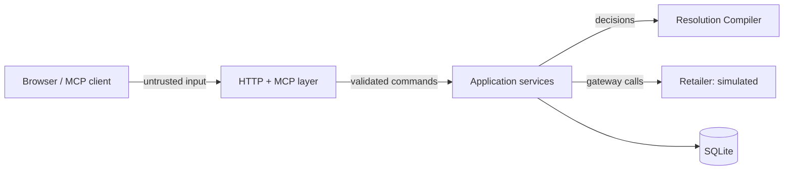

# Threat model

Scope: AFTERCARE as built in this repository. That is a single-tenant demo process with a simulated retailer, run locally or as one hosted service. This document says what is protected, how, and what is not.

## Assets

| Asset                                      | Why it matters                                                                               |
| ------------------------------------------ | -------------------------------------------------------------------------------------------- |
| Consequential operations (return requests) | A wrong or duplicate request costs money or creates fraud exposure in a real deployment      |
| Customer approvals                         | They are the only thing that authorizes a consequential operation                            |
| Case history (evidence, decisions, events) | It is the audit trail that explains every action                                             |
| Customer data                              | Order history, serial numbers and messages. All fictional here, but treated as personal data |

## Trust boundaries

1. **Client to server.** Everything arriving at `/mcp` and `/api` is untrusted: free text, IDs, serials and digests.
2. **Language to decision.** The interpreter's output is a _customer claim_. It can never approve, decide eligibility or trigger an operation.
3. **Server to retailer.** Responses can be lost, delayed or contradictory. Success is established only by reading the record back.

## Threats and controls

| Threat                                                              | Control                                                                                                                                                                                                                              | Where                                         |
| ------------------------------------------------------------------- | ------------------------------------------------------------------------------------------------------------------------------------------------------------------------------------------------------------------------------------ | --------------------------------------------- |
| DNS rebinding or a cross-site page driving the local server         | Host allow-list on loopback; `Origin` must be allow-listed (403 otherwise) on `/mcp` and `/api`                                                                                                                                      | `src/interfaces/http/app.ts`                  |
| Exposing the server publicly without auth                           | Startup refuses a non-loopback `HOST` unless `AFTERCARE_ACCESS_TOKEN` (16+ chars) is set, or `AFTERCARE_PUBLIC_DEMO=true` is set explicitly for the fictional-data judging demo; a configured token is required on `/mcp` and `/api` | `src/config.ts`, `app.ts`                     |
| Reading or changing another customer's case                         | Every use case loads the case through an ownership check; "not yours" and "missing" return the same `not_found`                                                                                                                      | `ResolutionService.loadOwned`                 |
| Malformed or oversized input                                        | zod schemas on MCP tool inputs and API bodies; 64 KB JSON limit; text capped at 2000 chars; serial format check                                                                                                                      | `tools.ts`, `app.ts`, `resolution-service.ts` |
| Approval inferred from conversation, or replayed after terms change | Approval requires the proposal ID **and** its SHA-256 digest; proposals are withdrawn when evidence changes; agreement in chat is logged as `approval.not_inferred`                                                                  | `approve`, compiler `supersedeProposalIds`    |
| Executing without approval                                          | `execute` requires the compiler's next step to be `submit_approved_action` for that proposal **and** an approval row with the matching digest                                                                                        | `ResolutionService.execute`                   |
| Duplicate submission                                                | Write-ahead operation record; unique idempotency key; refusal while an operation is accepted, confirmed or unknown; reconciliation before retry; 3-attempt cap                                                                       | `execute`, `checkOutcome`, schema constraints |
| Claiming success that did not happen                                | Postcondition verification against the retailer's record; lifecycle stages kept distinct                                                                                                                                             | `verifyReturnPostconditions`, `views.ts`      |
| Prompt injection through customer text or third-party pages         | No model decides anything. Third-party claims are inadmissible by the authority policy; customer statements cannot decide order or policy facts                                                                                      | `evidence.ts` `AUTHORITY`                     |
| Leaking internals in errors                                         | Domain errors map to stable codes and messages; unexpected errors return a generic 500 and are logged server-side only                                                                                                               | `app.ts` error handler                        |
| Demo controls abused                                                | Reset touches only the demo customer's cases and `sim_*` tables; every control is written to the timeline as `demo_control`                                                                                                          | `DemoService`                                 |

## Sensitive data

- No credentials, API keys or real personal data are in the repository. All seed data is fictional and labelled as such in `data/seed/retailer.json`.
- Logs contain startup lines and unexpected errors only. Customer messages are stored in the case database, which is the product's purpose, but they are not logged.
- The SQLite file (`var/aftercare.db`) is gitignored.

## Simulated integrations

The retailer, its policies, shipment records, return labels (`demo://` URLs) and carrier scans are simulated. The interface labels them as demo data or simulated, and so does the event log (`simulated: true` on retailer events). No real return, refund, label or notification is ever created.

## Known risks and gaps

- **Approval over MCP is as strong as the client.** The server records approval only through `approve_proposed_return`, which must name the exact proposal and its digest, and it refuses stale or mismatched approvals. It cannot verify that a human actually agreed: an MCP client that hears "yes, go ahead" can call the tool directly. The tool description instructs clients to confirm the exact terms first. Stronger options for a real deployment include MCP elicitation for confirmation, or a short read-back code shown to the customer. The web assistant surface sends approval only from its explicit button.
- **Demo identity.** There is no real customer authentication. The server acts for one configured demo customer (`AFTERCARE_DEMO_CUSTOMER`). A real deployment needs account linking (for Alexa+, OAuth 2.1 with PKCE per the Alexa+ MCP Toolkit docs, which participants cannot access) and per-request identity.
- **Demo controls are not role-gated.** `/api/demo/*` is open to anyone who can reach the API. With the access token set, it is limited to token holders. The hosted judging demo runs with `AFTERCARE_PUBLIC_DEMO=true` and no token, so anyone can reset or script it, and anyone can call `/mcp` as the demo customer. This is accepted because every record is fictional and the web app sends no token. A real deployment would remove these endpoints and require authentication.
- **No rate limiting** on `/mcp` or `/api`.
- **Exactly-once is not guaranteed externally.** Idempotency keys prevent duplicates only if the real retailer honours them. AFTERCARE's own controls (reconcile before retry, write-ahead records) reduce the risk; they cannot eliminate it.
- **Single process.** The per-case lock is in-memory. Running several instances against one database would rely only on optimistic version checks and unique constraints.
